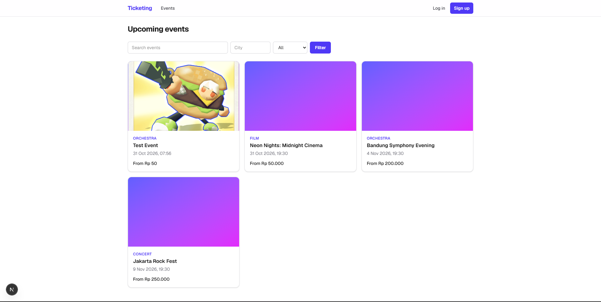
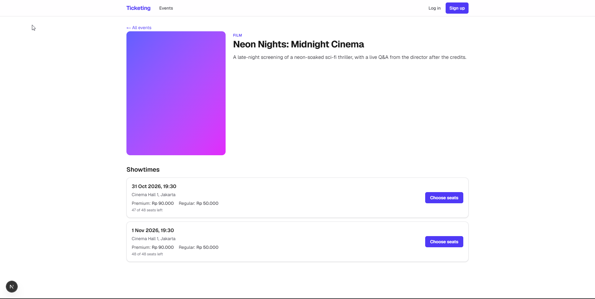
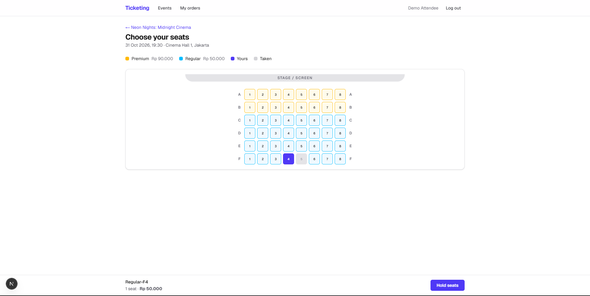
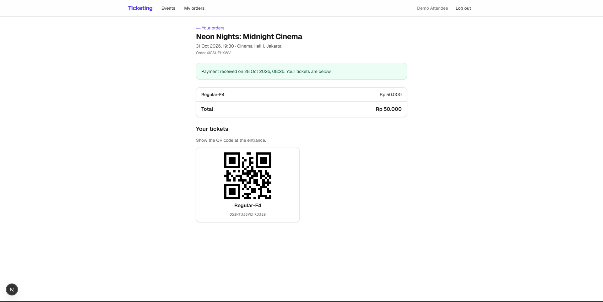
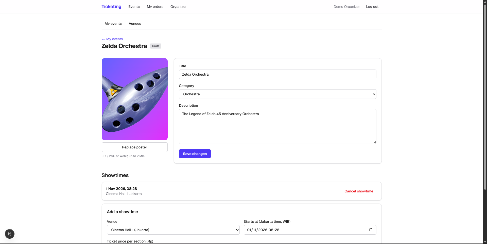
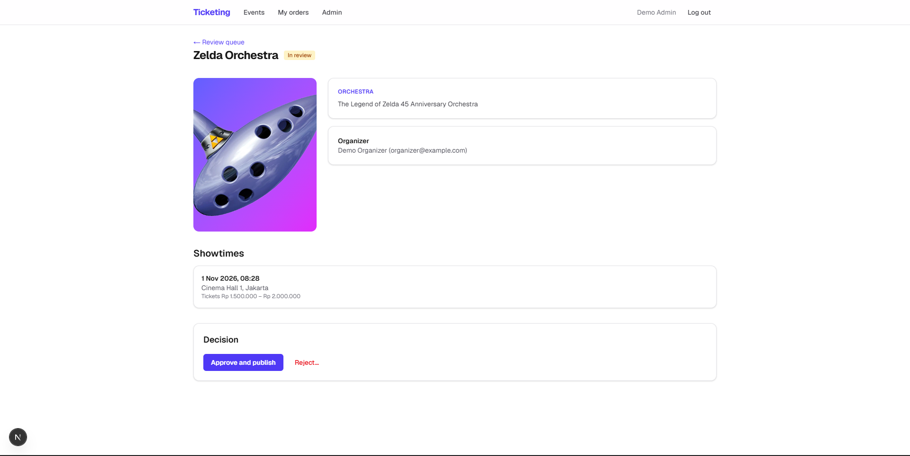

# Ticketing Web

The web client for a ticketing platform covering films, concerts, orchestras and other events. Attendees pick exact seats on a live seat map and pay through Midtrans, organizers manage venues and events, and admins review events before they are published.

It talks to the Laravel API in the separate `ticketing-api` repository, which holds the business rules, seat locking and payment handling.

Built with Next.js 16 (App Router), React 19, TypeScript, Tailwind CSS 4 and TanStack Query.

## Screenshots

| Events | Event detail |
| --- | --- |
|  |  |

| Seat picker | Paid order with QR tickets |
| --- | --- |
|  |  |

| Organizer: manage an event | Admin: review an event |
| --- | --- |
|  |  |

## Features

**Attendees**
- Browse upcoming events with search, city and category filters and pagination.
- Event pages with showtimes, section prices and live availability.
- Seat picker that polls the seat map every 5 seconds, lets you select up to 6 seats, holds them with a visible countdown, and lets you release them. Held seats also expire on their own after 10 minutes.
- Checkout with the Midtrans Snap popup, a "check status" button for when the webhook cannot reach the server, and cancellation of unpaid orders.
- Order history and QR-coded tickets, one per seat.

**Organizers**
- Venues with a seat-grid generator (sections, rows and seats per row).
- Event creation and editing, poster upload, showtimes with per-section prices, and submission for review. Rejected events show the admin's reason and can be edited and resubmitted.

**Admins**
- Review queue with tabs for waiting, published, rejected and draft events.
- Event detail with organizer, showtimes and prices, then approve or reject with a written reason.
- A warning when an event has no upcoming showtime and would not appear in the catalog.

## How it is put together

**The login token never reaches browser JavaScript.** Login and register go through Next.js route handlers that forward to Laravel and store the returned token in an `httpOnly` cookie. Server components read that cookie to call the API. Client components call a small proxy route (`/api/proxy/...`) that adds the `Authorization` header on the server. A side effect is that no CORS setup is needed, because the browser only ever talks to the Next.js origin. The proxy also handles binary uploads, clears the cookie when the API answers 401, and blocks calling login or register through it.

**Pages are guarded for convenience, the API for security.** `requireRole()` redirects guests to login (with a `?next=` return path that rejects open-redirect tricks) and sends other roles home. The Laravel API enforces roles again on every request, so hiding a page is never the only protection.

**Server components fetch, client components mutate.** Pages load data on the server with no caching, so what you see is current. Interactive parts (seat picker, order actions, forms) are client components using TanStack Query mutations, then refresh the page data.

**Times are shown in Asia/Jakarta.** The API stores UTC. Displayed times use the Jakarta time zone, and the `datetime-local` inputs in the showtime form are converted from Jakarta time to UTC before sending.

**Server clock offset for countdowns.** The seat hold countdown corrects for the difference between the browser clock and the server clock, so a wrong device clock does not show a wrong timer.

## Running it locally

You need Node.js 20 or newer and the API running (see the `ticketing-api` README).

```bash
npm install
```

Create `.env.local`:

```
# Base URL of the Laravel API, no trailing slash
API_URL=http://127.0.0.1:8000
```

Then:

```bash
npm run dev      # http://localhost:3000
```

Other scripts: `npm run build`, `npm run start`, `npm run lint`.

### Demo accounts

When the API is seeded in a local environment, these accounts exist. The password is `password` for all of them.

| Role | Email |
| --- | --- |
| Admin | `admin@example.com` |
| Organizer | `organizer@example.com` |
| Attendee | `attendee@example.com` |

### Try the whole flow

1. Sign in as the **organizer**, create a venue, then an event with a poster and a showtime, and submit it for review.
2. Sign in as the **admin**, open **Admin** in the navbar and approve the event.
3. Sign in as an **attendee**, open the event, pick seats and pay with the Midtrans sandbox test card `4811 1111 1111 1114`, any future expiry, CVV `123`, OTP `112233`.
4. Open the order to see the QR tickets.

## Project layout

```
src/
  app/
    page.tsx               event list
    events/[slug]/         event detail
    showtimes/[id]/        seat picker
    orders/                order list and order page
    login/, register/
    organizer/             venues, events, showtimes
    admin/                 review queue and decisions
    api/auth/*             login, register, logout route handlers
    api/proxy/[...path]/   authenticated proxy to the Laravel API
  components/              UI, with organizer/ and admin/ subfolders
  lib/                     API clients, guards, formatting, types
```

## Not built yet

- Ticket check-in screen for organizers (the API tables are ready for it).
- Email verification and password reset.
